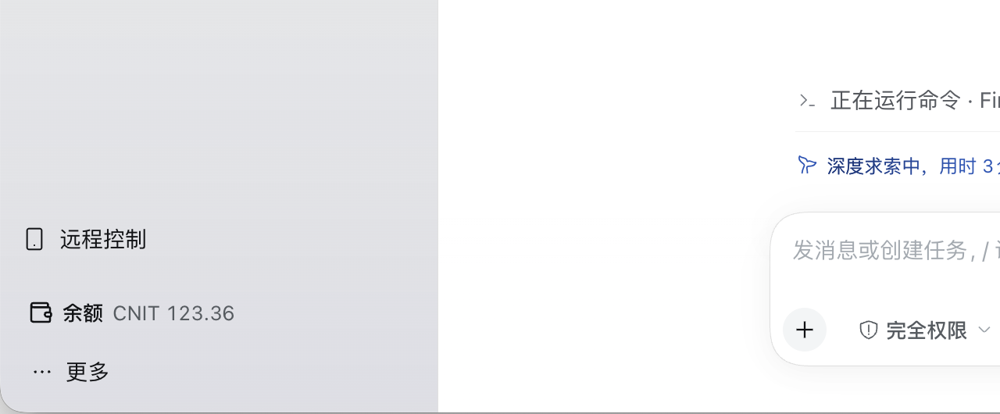

# 余额面板（dsh-token-usage）

DSH 插件：在左侧栏提供「余额」入口，点击切换到主面板，显示当前会话模型提供商的余额，
并按本会话 / 今天 / 近 7 天 / 近 30 天 / 历史累计统计 token 与费用。

## 功能概述

- 左侧栏底部（「远程控制」旁的页脚区）有「余额」入口：**跟随当前会话使用的提供商**。该提供商有手动余额时
  直接显示「提供商名 + 剩余金额」（不显示币种代码）；没有余额时显示「提供商名 未设置」。点击切换到主面板。
- 余额卡片：显示当前会话涉及的模型提供商的剩余余额。
- 统计面板：本会话、今天、近 7 天、近 30 天、历史累计五个口径的费用；token 明细行末尾（「合计」之后）
  显示 **缓存命中率**（cacheRead / (input + cacheRead + cacheWrite)）；可点选口径查看「按模型」明细，
  并显示近 14 天费用柱状图，鼠标悬停（或键盘聚焦）某一天可看到当天的日期、费用与 token 数。
- 面板右上角有刷新与关闭按钮，关闭后回到对话视图。
- 价格编辑：为每个已观察模型配置基础价、峰谷价与长上下文价。
- 余额编辑：按提供商手动填写余额。

侧栏底部的入口会直接显示当前提供商的剩余余额：



## 安装与启用

1. 在 DSH 插件管理器中从本地目录安装 `dsh-token-usage` 包（包内通过
   `dsh.bundle.patch` 声明 bundle 层）。
2. 启用插件，随后重启或刷新 Web UI。
3. 左侧栏底部出现「余额」入口；点击进入主面板。

## 统计口径

- **本会话**：当前会话及其派生的子代理会话（递归）。
- **今天 / 近 7 天（含今天）/ 近 30 天（含今天）/ 历史累计**：按本机自然日统计。
- 费用不使用调用发生时的价格：历史 token 一律按**当前价格**重算。

## 自定义单价

- 每个模型可配置四项单价：输入、输出、缓存读取、缓存写入，单位均为**每百万 tokens**。
- 计费公式（单次调用）：

  ```text
  prompt = input + cacheRead + cacheWrite
  cost = (input × 输入单价
        + output × 输出单价
        + reasoning × 输出单价
        + cacheRead × 缓存读取单价
        + cacheWrite × 缓存写入单价) / 1,000,000
  ```

- 未配置价格的模型按 0 计费，界面中其费用后带 `*` 标记。

## 峰谷时段

- 每个模型可配置谷时窗口，默认 **18:00–09:00**（跨午夜：当天 18:00 至次日 09:00），按本机时区。
- 支持跨午夜窗口（开始时间晚于结束时间）；窗口开始时刻包含、结束时刻不包含。
- 可勾选「周末」与「节假日」全天谷价：周末为周六 / 周日；节假日按
  `YYYY-MM-DD` 列表（本机自然日）匹配。

## 长短上下文

- 阈值为 promptTokens（`input + cacheRead + cacheWrite`），默认 **272000**。
- 当 promptTokens **严格大于**阈值、且配置了长上下文价格时，使用长上下文价。
- 价格分层优先级：**长上下文 > 峰谷 > 基础价**。

## 手动余额

- 按当前会话涉及的提供商分别填写余额；插件不会自动获取真实余额。
- 保存时以该提供商**当前历史累计费用**为基准（baselineCost）；此后该提供商的新增用量
  从余额中扣减。
- 余额看板只显示各提供商的剩余余额（未设置时显示「未设置」）。
- 修改价格会重算历史费用，因此剩余余额会随之变化。

## 子代理计入

- 本会话统计包含子代理会话（`origin=subagent` 或 `delegationDepth>0`），递归汇总。

## 状态文件

- `$DSH_HOME/token-usage/state.json`（`DSH_HOME` 缺省为 `~/.dsh`）。
- 保存价格、余额与货币配置；原子写入。

## 排错

- 点击面板顶部的刷新按钮重新拉取统计；点击关闭按钮回到对话。
- 费用后的 `*` 表示该模型未定价。
- `incomplete` 为 `true` 表示会话列表或会话读取失败，统计数据可能不完整。
- 诊断文件：
  - `$DSH_HOME/token-usage/last-request.json`：最近一次 API 请求结果。
  - `$DSH_HOME/token-usage/self-check.json`：插件启动时的自检结果（统计摘要或错误）。
